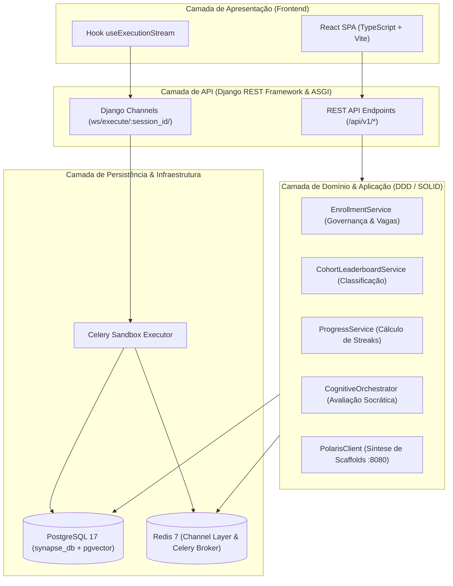

# Synapse — Plataforma Educacional SaaS

Plataforma de ensino prático e contínuo com arquitetura orientada a **Domain-Driven Design (DDD)**, **SOLID** e **ORM**, equipada com avaliação socrática adaptativa, sandbox de código com streaming WebSocket e governança de risco com telemetria auditável.

---

## 📋 Arquitetura e Bounded Contexts



### Módulos Principais

| Módulo / App | Responsabilidade de Domínio |
| :--- | :--- |
| **`courses`** | Catálogo de cursos, módulos, lições e turmas. Serviços: [`EnrollmentService`](file:///services/synapse/courses/services/enrollment_service.py), [`CohortLeaderboardService`](file:///services/synapse/courses/services/leaderboard_service.py), [`ProgressService`](file:///services/synapse/courses/services/progress_service.py) e [`PolarisClient`](file:///services/synapse/courses/services/polaris_client.py). |
| **`submissions`** | Modelagem de problemas práticos (`Problem`) e entregas de código (`Submission`) com `user` protegido contra IDOR e persistência de `correlation_id`. |
| **`cognition`** | Motor de avaliação socrática (`CognitiveOrchestrator`), sondagem de raciocínio causal, detecção de frustração e relatórios cognitivos (`CognitiveReport`). |
| **`users`** | Autenticação JWT, governança RBAC padrão (`setup_rbac`) e endpoint de métricas de estudo em tempo real (`/api/v1/auth/me/stats/`). |
| **`payments`** | Webhooks Stripe para checkout e planos com registro auditável e imutável em `PaymentLog`. |
| **`sandbox`** | Execução isolada de código do estudante e streaming bidirecional via Django Channels (`ExecutionConsumer`). |
| **`frontend`** | Interface SPA em React 18 (TypeScript, Tailwind, Vite), integrando o hook reativo [`useExecutionStream`](file:///services/synapse/frontend/src/hooks/useExecutionStream.ts) com reconexão automática e fallback para polling REST. |

---

## 🚀 Início Rápido (Ambiente Local)

### Pré-requisitos
- Python 3.11+ (ou 3.13 no Debian WSL2)
- PostgreSQL 17 local (`synapse_db` com `pgvector`)
- Redis Server local (`127.0.0.1:6379`)
- Node.js 20+

### 1. Configuração do Ambiente Virtual Python
```bash
python3 -m venv .venv
source .venv/bin/activate
pip install -r requirements.txt -r dev-requirements.txt
```

### 2. Configuração de Variáveis de Ambiente (`.env`)
```ini
DEBUG=True
SECRET_KEY=synapse-development-key-2026
ALLOWED_HOSTS=localhost,127.0.0.1

POSTGRES_DB=synapse_db
POSTGRES_USER=synapse
POSTGRES_PASSWORD=synapse_pass
POSTGRES_HOST=127.0.0.1
POSTGRES_PORT=5432

REDIS_URL=redis://127.0.0.1:6379/0
LLM_PROVIDER=mock
```

### 3. Migrações e Povoamento Inicial (Grade Flagship)
```bash
# Aplicar migrações estruturais
python manage.py migrate

# Provisionar grupos canônicos RBAC (Administrators, Instructors, Students, Auditors)
python manage.py setup_rbac

# Popular o banco com os 6 cursos iniciais e desafios práticos de Sandbox
python scripts/seed_data.py
```

### 4. Compilação do Frontend
```bash
cd frontend
npm install
npm run build
```

---

## 🧪 Suíte de Testes Automatizados

A suíte de testes é executada com `pytest` utilizando o isolamento configurado em `pytest.ini` e `synapse_project/test_settings.py`:

```bash
# Executar todos os testes de unidade e API (sem dependências externas)
.venv/bin/pytest
```

**Resultado consolidado**: **49 testes automatizados com 100% de aprovação** em ~1,6 segundos, cobrindo:
- Serviços de inscrição, turmas, streaks e leaderboard (`courses`).
- Orquestrador de avaliação socrática (`cognition`).
- Governança de grupos RBAC e endpoint `/me/stats/` (`users`).
- Roteamento e persistência de auditoria de webhooks (`payments`).
- Integridade de submissões de código e logs de sandbox (`submissions`).
- Propagação de `correlation_id` via middleware (`core`).

---

## 🔒 Governança e Segurança

1. **Isolamento de Rede (100% Loopback)**: Todas as conexões de banco de dados e APIs internas operam estritamente vinculadas a `127.0.0.1`, evitando exposição desnecessária em interfaces de rede públicas.
2. **Proteção IDOR**: Serializers de escrita não aceitam campos de identidade manipuláveis pelo cliente (`user = PrimaryKeyRelatedField(read_only=True)`).
3. **Auditoria Transacional**: Toda ação crítica de pagamento e submissão persiste metadados enriquecidos com `correlation_id` para fins forenses e de conformidade.
